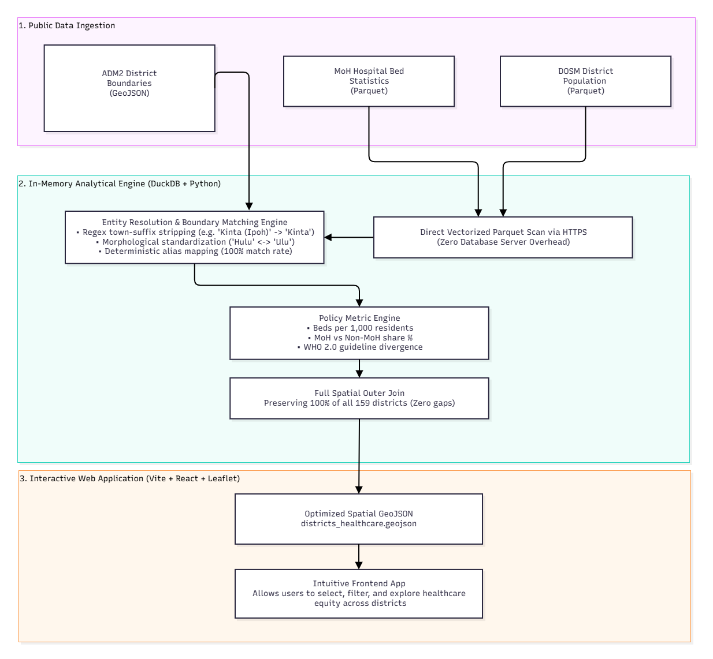

# 🏥 Malaysia Healthcare Equity Spatial Exploration (MYS-HSE)

> **An interactive spatial analytics platform and reproducible computational data pipeline evaluating hospital bed capacity, demographic equity, and healthcare accessibility across all 159 Malaysian administrative districts.**

[](https://maiakmal1610.github.io/mys-health-spatial-explorer/)
[](https://python.org)
[](https://duckdb.org)
[](https://react.dev)
[](https://www.typescriptlang.org/)
[](https://leafletjs.com)
[](https://tailwindcss.com)
[](https://data.gov.my)
[](https://github.com/maiakmal1610/mys-health-spatial-explorer/actions)

---

## 🎯 Executive Summary 

In national socioeconomic planning, headline statistics frequently mask severe spatial inequities. While Malaysia maintains an aggregate national hospital bed ratio hovering near standard baselines, access is starkly stratified across different state and district.

Developed as a portfolio project, this project answers three foundational public policy questions:
1. **Geographic Distribution:** Which state or district face critical bed deficits relative to their residential populations?
2. **Public vs. Private Polarization:** Where is public healthcare (Ministry of Health / KKM) the sole lifeline versus where does the private tertiary sector absorb caseloads?
3. **Spatial Healthcare Deserts:** How do rapid-growth suburban perimeters and newly gazetted administrative districts cope without localized inpatient hospital infrastructure?

---

## 💡 Key Empirical & Policy Findings

* **Suburban & Peripheral Deficits:** Major urban spillover districts (e.g., Petaling, Hulu Langat, Gombak) face acute bed pressure per capita despite their proximity to state capitals, as population inflows outpace healthcare facility expansion.
* **The "Zero-Bed" Referral Dependency:** 7 administrative districts (including *Bagan Datuk, Muallim, Selama, Kuala Nerus, Kalabakan, Kecil Lojing, and Telang Usan*) have zero gazetted inpatient hospital beds within the district, making residents entirely dependent on cross-boundary hospital referrals.
* **Extreme Public Sector Reliance:** While metropolitan centers in Selangor and Penang exhibit 35%–45% private healthcare absorption, rural Sabah and Sarawak rely almost **100% on public MoH facilities**, emphasizing the outsized role of fiscal federal healthcare spending in regional equity.

---

## 🏗️ Architecture & Data Pipeline

The solution decouples computational analytical processing from the browser client through a high-performance, reproducible two-tier architecture:

<p align="center">
  
</p>

---

## 🔬 Data Engineering & Methodology

### 1. Vectorized Cloud Parquet Extraction
Rather than running an expensive relational database server, the pipeline executes SQL queries directly over remote Parquet files using **DuckDB**:
* **Live Parquet Querying:** Reads `storage.data.gov.my` and `storage.dosm.gov.my` directly in-memory via SIMD-accelerated columnar operations.
* **Zero Infrastructure Footprint:** Entire pipeline executes deterministically in under 5 seconds with zero local database configuration.

### 2. Entity Resolution & 100% District Coverage
A notorious issue in Malaysian geospatial data is string divergence across administrative registers (e.g. `"Batang Padang (Tapah)"` vs `"Batang Padang"`, `"Larut & Matang"` vs `"Larut dan Matang"`, `"W.P. Putrajaya"` vs `"Sepang"`).

The pipeline resolves this via an automated three-stage normalization algorithm:
1. **Regex Town Stripping:** `re.sub(r'\s*\([^)]*\)', '', raw_name)`
2. **Linguistic Orthography Standardisation:** Bi-directional mapping of `Hulu` $\leftrightarrow$ `Ulu` and `&` $\leftrightarrow$ `dan`.
3. **Canonical Spatial Crosswalk:** Deterministic mapping linking historical gazetted splits and sub-districts.
4. **Full Outer Boundary Retention:** All 159 boundary polygons from the official ADM2 layer are preserved, ensuring zero missing polygons or map "holes".

### 3. Core Policy Metrics
* **Bed-to-Population Ratio (Capacity):**
  $$\text{Beds per 1k} = \frac{\text{Total Beds}}{\text{District Population}} \times 1,000$$
* **Public Hospital Dependency (Reliance):**
  $$\text{MoH Share \%} = \frac{\text{MoH Beds}}{\text{Total Operational Beds}} \times 100$$
* **Healthcare Equity Benchmarking:**
  * 🔴 **Critical Deficit (< 1.5 beds / 1k):** Severe strain on inpatient infrastructure; acute risk of bed shortages.
  * 🟡 **Moderate Access (1.5 – 2.5 beds / 1k):** Baseline primary capacity aligned with national averages.
  * 🟢 **Well-Served (≥ 2.5 beds / 1k):** Regional tertiary referral centers servicing broad cross-district patient bases.
  * ⚪ **Zero-Bed District (0.0):** Districts lacking gazetted inpatient facilities, dependent on regional hubs.

---

## 💻 Modern Tech Stack

| Layer | Technology | Rationale |
| :--- | :--- | :--- |
| **Data Engine** | Python 3.12, DuckDB | Fast, zero-dependency columnar OLAP queries on remote Parquet. |
| **Frontend Framework** | React 18, TypeScript, Vite | Componentized UI with sub-second HMR and strict type safety. |
| **Spatial Mapping** | Leaflet 1.9, Multi-provider Tiles | Smooth vector styling, custom canvas choropleths, and zero API-key dependencies. |
| **Tile Providers** | Google Maps, Esri, Waze, OSM, CartoDB | 7 selectable raster basemaps spanning satellite imagery, terrain, and dark vector tiles. |
| **Design & UI** | Tailwind CSS 3.4, Lucide React | Curated slate-dark theme, glassmorphic floating cards, and OpenDOSM data typography. |
| **CI/CD** | GitHub Actions | Automated build, type validation, and deployment to GitHub Pages. |

---

## 📊 Interactive Geoportal 

* **State & District Drilldown:** Filter across all 16 states & federal territories or search by district name.
* **Attribute Cards:** Display comprehensive healthcare metrics for selected areas.
---

## 🚀 Local Development & Reproduction

### Prerequisites
* **Python 3.10+**
* **Node.js 18+ & npm**

### 1. Clone Repository
```bash
git clone https://github.com/maiakmal1610/mys-health-spatial-explorer.git
cd mys-health-spatial-explorer
```

### 2. Run the Data Pipeline (Python + DuckDB)
```bash
# Install pipeline dependencies
pip install -r pipeline/requirements.txt

# Execute data pipeline (fetches live Parquet & compiles GeoJSON)
python pipeline/run_pipeline.py
```

### 3. Launch Frontend Development Server
```bash
# Install frontend dependencies
npm install

# Start local dev server
npm run dev
```

Open `http://localhost:8080` in your web browser.

### 4. Build for Production
```bash
npm run build
```

The optimized static production assets will be generated in `dist/`.

---

## 📜 Official Data Attribution

* **Ministry of Health Malaysia (KKM)** — Operational hospital bed data via [data.gov.my](https://data.gov.my).
* **Department of Statistics Malaysia (DOSM)** — District population and demographic projections via [open.dosm.gov.my](https://open.dosm.gov.my).
* **geoBoundaries (Runfola et al.)** — ADM2 administrative boundary vector polygon datasets.

---

## 👤 Author & Contact

Mai
GitHub: [@maiakmal1610](https://github.com/maiakmal1610)  
Live Geoportal: [https://maiakmal1610.github.io/mys-health-spatial-explorer/](https://maiakmal1610.github.io/mys-health-spatial-explorer/)
